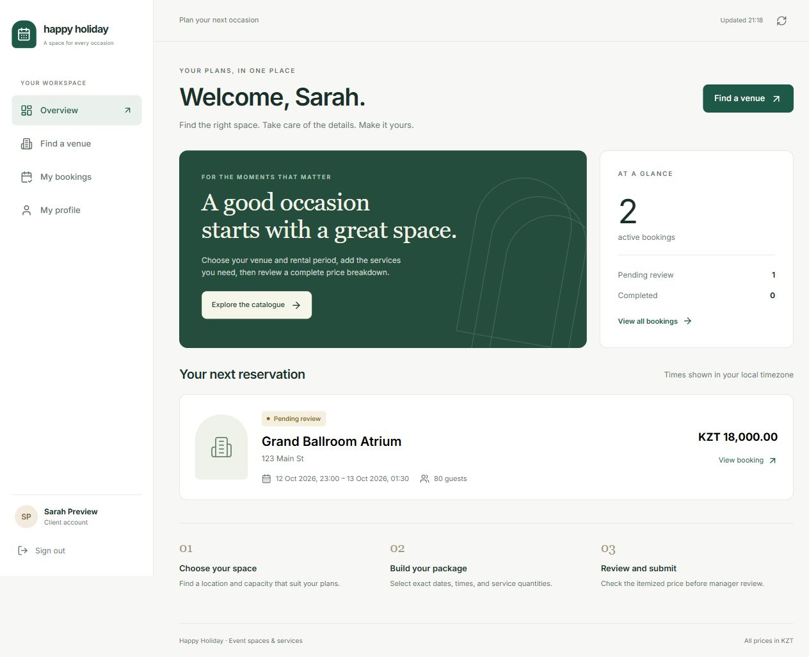
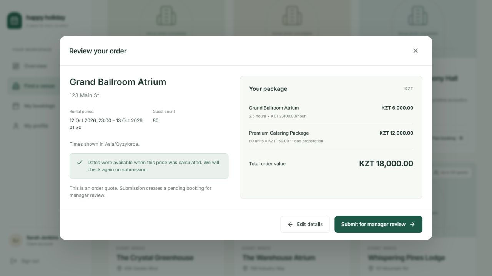
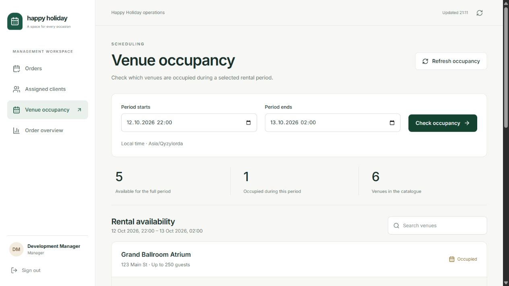
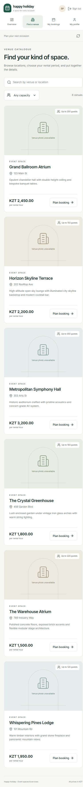

# Frontend Sprint 2 and UI/UX review

Implemented on 2026-10-11 against the [revised Sprint 2 plan](https://docs.google.com/document/d/1IoAJ1WBlfbxq47H66oPKdnwQpbUmW7Eh/edit) and the backend API implemented in this repository.

## Design and behavior changes

The interface now uses an ivory/green palette, a consistent navigation shell, clear page hierarchy, restrained typography, readable tables, and responsive layouts. Venue illustrations are neutral placeholders explicitly labeled when an actual venue photo is unavailable. Arbitrary stock photographs no longer pretend to represent real venues.

| Misleading or broken experience | Corrected experience |
| --- | --- |
| Fixed revenue, growth, client, and occupancy statistics | Order overview derives its figures from loaded orders; order value is explicitly distinct from collected revenue |
| Invented weekly schedules | Manager occupancy is queried for the selected period and displays actual overlapping bookings |
| Invoice generation/delivery buttons that only displayed success messages | Removed unsupported invoice actions |
| Booking modification fields that discarded edits and changed only status | Removed unsupported modification controls |
| Cancellation available for every status and dialog closed before the API responded | Only pending/unpaid orders offer cancellation; dialog stays open for failures and closes after server confirmation |
| Submission described as a confirmed booking | Submitted order is labeled pending review, with real manager assignment information |
| Instant calculations presented as final authoritative pricing | A server quote is required before submission; exact itemized rates/quantities/totals are displayed, and creation checks availability again |
| Fixed/default dates and rounded-up hours | Exact local start/end timestamps, fractional hours, overnight and multi-day periods; explicit timezone shown |
| Admin form errors treated as success | Shared API error handling covers all mutations, validation, permissions and history conflicts |
| Fake completed booking counts in client profiles | Total bookings is labeled as a count across all statuses, scoped to assigned orders for managers |
| Clipboard success reported before writing | Copy action waits for the clipboard result and reports failures |
| Login screen published admin passwords | Credentials are removed from the UI; sign-in and registration use proper autocomplete and separate password-show control |
| Stale persisted roles trusted at startup, expired sessions showing empty data | Account is validated on startup, unauthorized requests return to sign-in, loading and retry states are explicit |
| Mouse-only dialog and background navigation | Dialog semantics, focus trap/restoration, Escape handling, inert background, labeled controls, visible focus and skip-to-content behavior |

Unsupported future-sprint invoice, payment, change-request and financial-reporting flows are not presented as working actions. Existing booking statuses remain visible, but the frontend does not manually simulate payment or approval.

## Sprint 2 acceptance criteria

| Story | Frontend implementation | Status |
| --- | --- | --- |
| 3.1 Profile | View/save name, email and phone through the backend; duplicate/invalid contact errors remain visible | Implemented |
| 4.1 Premise/date selection | Search venue name/address and capacity; exact start/end and guest count; overnight periods | Implemented |
| 4.2 Three-premise policy | Explain separate venue orders and limit; authoritative limit errors from quote/create shown inline | Implemented |
| 7.2 Service selection | Optional catalogue services with explicit integer quantities and per-unit rates | Implemented |
| 4.3 Submission/assignment | Review-first submission, pending status, stored order details, real manager-assignment indicator | Implemented |
| 5.1 Occupancy | Manager/admin period search with available/occupied venues and booked intervals | Implemented |
| 5.2 Conflict prevention | Quote failures preserve the form; submission failures invalidate the quote and return to editable details | Implemented |
| 8.1 Pricing | Use the backend's calculation; no client-supplied total is submitted | Implemented |
| 8.2 Breakdown | Rental hours/rate and each service quantity/rate, line totals and order value before submission and in stored details | Implemented |

Administrator staff forms also support manager client limits. Catalogue and staff changes refresh server data after successful writes. Records with booking history are protected by backend conflict responses.

## Local development

```powershell
npm install
npm run dev
npm test
npm run build
```

The default API endpoint is `http://localhost:5294/api`. For another endpoint, set `VITE_API_URL` before starting Vite or building; this value is embedded in the client build. Cross-origin deployments must configure the backend's `Cors:AllowedOrigins` list, for example `Cors__AllowedOrigins__0=http://127.0.0.1:3001` for a local preview. The default backend allowlist includes localhost and 127.0.0.1 on ports 3000 and 5173. Production credentials belong in server configuration, never frontend variables.

The frontend expects the migrated Sprint 2 API. See [backend rollout instructions](backend-sprint2.md) for an old EnsureCreated database. No existing application data was modified by this frontend work.

## Verification

- Eight frontend regression tests pass: exact overnight/fractional periods, service quantities, invalid date/capacity/quantity rejection, optional services, chronological upcoming reservations, status-based cancellation, API conflicts/validation/no-content responses, abort handling, expired sessions, and network errors.
- Production Vite build passes.
- Browser testing used the real API and an isolated PostgreSQL preview database. Verified client sign-in, a 2.5-hour overnight order with 80 catering units and a KZT 18,000 quote, submission to pending review, profile persistence after reload, overlap errors, manager occupancy of that order, venue-rate save, and manager client-limit save.
- Desktop and 390-pixel mobile layouts were inspected. The mobile catalogue had no page-level horizontal overflow. Dialog background was inaccessible while open; input labels and focus behavior were checked. No browser console warnings or errors were observed in the tested flow.
- All 13 backend regression tests also passed with `HAPPYHOLIDAY_TEST_POSTGRES` pointing to isolated test databases.

Screenshots use seeded/preview data, not the user's existing application database:









The review covers implemented flows, not an exhaustive accessibility certification or full cross-browser test matrix. Paid cancellations, invoices, payment, rescheduling, and later-sprint reporting remain separate backend/frontend work.

A development preview is running at `http://127.0.0.1:3001` against the separate `hh_frontend_preview` database on loopback port 15439, with its backend at `http://localhost:5295`. These are temporary local processes for reviewing the interface, not a deployment of the user's existing database. The PostgreSQL data directory is `.test-postgres` and is excluded from Git and Docker build contexts.
